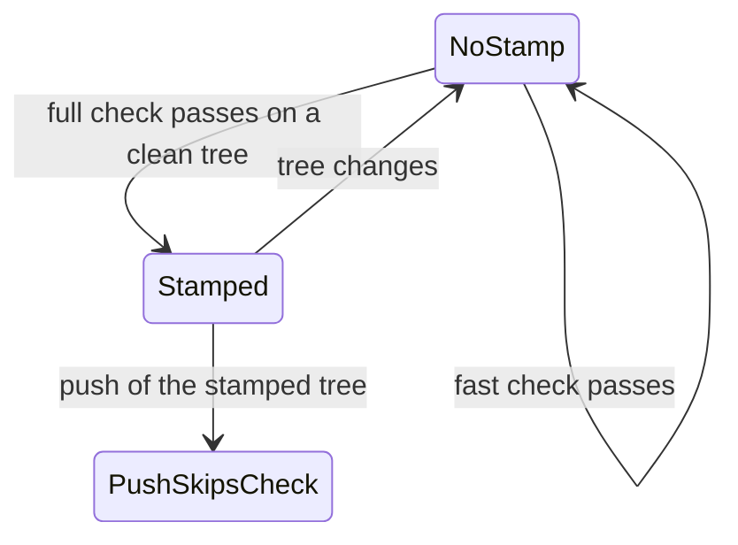

# Visual types for a pull request Summary

Pick the smallest visual that makes the change clear. Use one, or a few, never all. Show a full code block only when most of the code in it is new.

## Pseudocode

Use it for a change in an algorithm or a rule.

```
if arg is untrusted text and slot wants String:
    error E0300 at arg                          # new: was accepted
```

## Call tree

Use it when the path of a call changed.

```
check_program
└── check_module
    ├── resolve_imports
    └── check_items        ← now runs after resolve_imports, not before
```

## Crate edge

Use it when a crate gains or loses a dependency on another workspace crate.

```
oska-run ──► oska-check, oska-native, oska-syntax, oska-sys
oska-native ──► oska-check, oska-syntax   (new: was oska-syntax only)
```

## Short file tree

Use it when files moved or a new module appeared.

```
crates/oska-run/src/
├── host.rs
└── host/
    ├── real.rs     (moved from host.rs)
    └── fake.rs     (moved from host.rs)
```

## Mermaid diagram

Use it for a state change or a flow with branches.



## Diff-style sketch

Use it to show one part of a type, a signature, or a table that changed.

```diff
 pub struct Platform {
     pub table: &'static str,
-    pub syscall: fn(Sys) -> u16,
+    pub call: fn(Sys) -> OsCall,
 }
```
